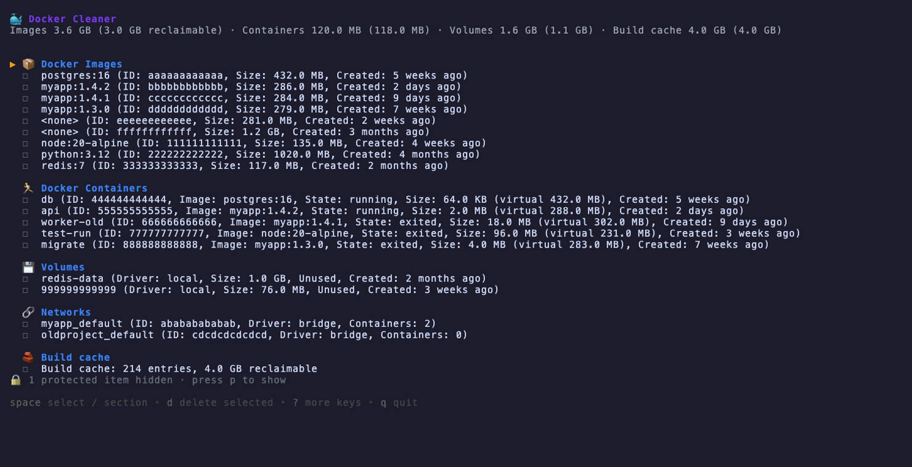

## Docker Cleaner

[](https://github.com/minhajul/docker-cleaner/actions/workflows/ci.yml)
[](https://github.com/minhajul/docker-cleaner/releases)
[](LICENSE)

A terminal UI for finding and removing Docker images, containers, volumes, networks and build cache, built with Go and [Bubble Tea](https://github.com/charmbracelet/bubbletea).



### Features

- Lists your images, containers (running and stopped), volumes, networks and build cache, with sizes, state and what is in use
- Sums up disk usage per type, and how much of it is reclaimable, like `docker system df`, and keeps a running total of what you have selected
- Hides Kubernetes, minikube, k3s and kind system resources so you can't break your cluster, plus anything you list in a [protect-list](#protecting-resources)
- Select items one by one, a whole section, or everything
- Filter to dangling images, stopped containers, unused resources or old items, and search by name
- Sort by size, age or name, and see how old each item is
- Asks before deleting, shows how much space will be freed, and warns about running containers
- Reports each failure with its reason, and offers a forced retry for images that are in use or have several tags
- Works with Docker Desktop, Colima, OrbStack, Rancher Desktop and Podman through your current Docker context
- Has a [non-interactive `prune` command](#non-interactive-use) with the same filters and protection, for scripts, cron and CI

### Installation

**Homebrew** (macOS and Linux):

```bash
brew install --cask minhajul/tap/docker-cleaner
```

**Go** (1.26 or later):

```bash
go install github.com/minhajul/docker-cleaner@latest
```

**Binaries:** download an archive for macOS, Linux or Windows from the [releases page](https://github.com/minhajul/docker-cleaner/releases).

### Usage

Make sure Docker is running, then:

```bash
docker-cleaner
```

Select what to remove and press `d`. Nothing is deleted until you confirm with `y`.

docker-cleaner connects to the same daemon as the `docker` CLI: `DOCKER_HOST` if it is set, otherwise the context named by `DOCKER_CONTEXT`, otherwise your current context (`docker context use`).

```text
docker-cleaner --version         Print the version
docker-cleaner --help            Show flags and keys
docker-cleaner --config <path>   Use another config file
docker-cleaner prune [flags]     Delete what filters match, without the UI (see Non-interactive use)
```

#### Keys

| Key | Action |
|---|---|
| `↑`/`k`, `↓`/`j` | Move the cursor |
| `pgup`/`pgdown`, `g`/`G` | Page up/down, jump to first/last row |
| `space`/`enter` | Select an item; on a section header, select or clear the whole section |
| `a` / `n` | Select all / select none |
| `r` | Refresh the lists |
| `d` | Delete selected (asks for confirmation) |
| `y` / `f` / `n` | In the confirmation: delete / force-delete running or paused containers / cancel |
| `f` | After a cleanup: force-remove images that failed because they are in use or have several tags |
| `p` | Show or hide protected items (listed read-only, never selected) |
| `/` | Search by name as you type; `enter` keeps the search, `esc` clears it |
| `D` | Show only dangling (untagged) images |
| `S` | Show only stopped containers (exited, created or dead) |
| `U` | Show only unused images, volumes and networks |
| `O` | Show only items older than 7, 30 or 90 days (each press moves on; after 90, off) |
| `esc` | Clear all filters and the search |
| `s` | Sort each section by size (largest first), age (oldest first), name, or back to Docker's order |
| `?` | Show all keys |
| `q`, `ctrl+c` | Quit |

### Filters and search

A filter narrows the sections it applies to and leaves the others alone, so `D` shows only dangling images but still lists every container, volume and network. Filters combine: `U` and `O` together show unused images and volumes older than 7 days. No filter hides the build cache.

| Filter | Images | Containers | Volumes | Networks |
|---|---|---|---|---|
| `D` dangling | untagged only | | | |
| `S` stopped | | exited, created or dead | | |
| `U` unused | no container uses it | | no container mounts it | no container attached |
| `O` older than | created before | created before | created before | |

"Unused" counts stopped containers too: an image a stopped container was created from is in use. Docker does not report when a network was created, so `O` leaves networks alone; an image, container or volume whose creation time is unknown is hidden by `O`.

The search (`/`) keeps the rows whose name or text contains what you type, ignoring case, in every section. A line under the list names the active filters and search, e.g. `Filters: dangling · older than 30d · "postgres" (esc clears)`.

`s` sorts the rows within each section: by size (largest first), by age (oldest first, the likeliest to be stale) or by name, then back to the order Docker lists them in. The line under the list shows the order (`Sort: size`); `esc` clears the filters but keeps it. Each image, container and volume shows its age (`Created: 3 weeks ago`); networks show none, since Docker does not report it, and sort by age in Docker's order.

Selected items that a filter or the search hides stay selected, but deleting acts only on the selected items you can see. The line under the list counts the hidden ones (`+3 selected hidden by filters`), and the confirmation says they will be kept. Clear the filters with `esc` to see them again.

### Protecting resources

Resources you never want to delete can be listed in a config file at `~/.config/docker-cleaner/config.yaml` (or `$XDG_CONFIG_HOME/docker-cleaner/config.yaml` if `XDG_CONFIG_HOME` is set; macOS uses the same path). Pass `--config <path>` to use another file. The file is optional.

```yaml
# Resources matching any pattern are hidden and can't be deleted.
protect:
  - "postgres:*"        # image repo:tag glob
  - "my-db"             # container name
  - "prod-*"
```

Protected resources, including the built-in Kubernetes ones, are hidden; a line under the list counts them (`🔒 3 protected items hidden · press p to show`). Press `p` to list them dimmed with a 🔒 and the reason (`system` or `protect-list`). They can't be selected, so select all and delete never touch them.

Matching rules:

- Patterns are globs: `*` matches any run of characters, `?` one character, `[a-z]` a set; `\` escapes. Unlike file-name globs, `*` and `?` also match `/`.
- A pattern must match a whole name, and case matters.
- Every pattern is checked against every resource:
  - an **image** by each tag and each tag's repository, so `postgres` and `postgres:*` protect every `postgres` tag, while `postgres:16` protects only that tag. Untagged (`<none>`) images match nothing.
  - a **container** by its name, without Docker's leading `/` (a leading `/` on a pattern is ignored too). A container is not protected by its image's name, but the image a protected container runs on is protected too, so it can't be untagged from under it.
  - a **volume** or **network** by its name. Docker's predefined `bridge`, `host` and `none` networks are never listed.

| Pattern | Matches | Doesn't match |
|---|---|---|
| `postgres` | image `postgres:16`, container `postgres` | `postgres-exporter:1`, container `my-postgres` |
| `postgres:1?` | `postgres:15`, `postgres:16` | `postgres:9`, `postgres:16.4` |
| `ghcr.io/acme/*` | `ghcr.io/acme/api:1.0`, `ghcr.io/acme/tools/cli:2` | `ghcr.io/other/api:1.0` |
| `prod-*` | container `prod-web-1`, image `prod-api:2.1` | `staging-prod-web` |

A malformed file, an unknown key (such as a misspelt `protect`) or an invalid pattern stops docker-cleaner with an error naming the file.

### Non-interactive use

`docker-cleaner prune` deletes what the filters match without opening the UI, for scripts, cron jobs and CI runners. It takes the TUI's filters as flags and selects exactly what the TUI would show with them, and it never deletes protected resources (the built-in system rules, your protect-list and the images protected containers run on) or Docker's predefined networks.

```bash
docker-cleaner prune --dangling --dry-run              # see what would go
docker-cleaner prune --dangling --older-than 7d --yes  # delete it
```

| Flag | Meaning |
|---|---|
| `--dangling` | Untagged images |
| `--stopped` | Stopped containers (exited, created or dead) |
| `--unused` | Images, volumes and networks no container uses, running or stopped |
| `--older-than <age>` | Images, containers and volumes created more than `age` ago: `30d`, `2w`, `12h` |
| `--type <types>` | Comma-separated: `images`, `containers`, `volumes`, `networks`, `build-cache` |
| `--dry-run` | List what would be deleted, and what is skipped and why; delete nothing |
| `-y`, `--yes` | Delete without asking |
| `--force` | Also remove running containers, and images that containers use or that have several tags |
| `--json` | Print one JSON object instead of text |
| `--config <path>` | Use another config file |

Each filter narrows only the types it applies to (see the table under [Filters and search](#filters-and-search)), and filters combine with AND. Without `--type`, prune acts on every type an active filter narrows, so `--dangling` prunes only images and `--older-than 30d` prunes images, containers and volumes. `--type build-cache` prunes all unused build cache, whatever the filters; it is never included unless named.

Since it deletes unattended, prune is careful:

- **No filter, no prune.** Without a filter it refuses to run (exit 2), so it never means "delete everything". The one exception is `--type build-cache` alone, which does what `docker builder prune` does. It also refuses a `--type` that no given filter narrows: `--dangling --type volumes` would delete every volume.
- **It asks first.** Without `--yes` or `--dry-run`, it shows the plan and asks `Delete 5 items (1.2 GB)? [y/N]` when run in a terminal, and refuses (exit 2) when stdin is not a terminal, as under cron or CI.
- **Protected and in-use resources are skipped.** Protected resources are never deleted. Without `--force`, running containers, and images and volumes that a container which stays uses, are skipped too rather than failing. `--dry-run` lists every skipped resource with its reason.

```text
$ docker-cleaner prune --older-than 30d --dry-run
Containers (1)
  ID            NAME     SIZE    CREATED      MATCHED
  cccccccccccc  old-job  3.0 MB  5 weeks ago  older than 30d

Images (2)
  ID            NAME      SIZE      CREATED       MATCHED
  111111111111  <none>    100.0 MB  5 weeks ago   older than 30d
  444444444444  alpine:3  8.0 MB    3 months ago  older than 30d

Skipped (3)
  TYPE       ID            NAME          REASON
  container  bbbbbbbbbbbb  web           container is running; pass --force to remove it
  image      333333333333  postgres:16   used by protected container
  image      555555555555  nginx:latest  used by container web; pass --force to remove it

Would delete 3 items (111.0 MB). Dry run: nothing was deleted.
```

A real run prints a line per resource (`deleted` or `failed` with the reason) and a summary such as `Deleted 4 · Failed 1`. With `--json`, it prints a single object instead, for a dry run and a real run alike:

```json
{
  "dry_run": false,
  "filters": ["dangling"],
  "types": ["images"],
  "planned": [{"id": "sha256:1111…", "name": "<none>", "type": "image", "size": 104857600, "created": "2026-09-07T12:00:00Z", "reason": "dangling"}],
  "deleted": [{"id": "sha256:1111…", "name": "<none>", "type": "image", "size": 104857600, "created": "2026-09-07T12:00:00Z", "reason": "dangling"}],
  "failed": [],
  "skipped": [],
  "totals": {"planned": 1, "planned_size": 104857600, "deleted": 1, "deleted_size": 104857600, "failed": 0, "skipped": 0, "build_cache_reclaimed": 0}
}
```

`size` is in bytes (`null` when Docker does not report it), and a failed entry's `reason` says why, with `"forceable": true` when `--force` may help.

Exit status: `0` when everything planned was deleted (or there was nothing to delete), `1` when a removal failed or Docker could not be reached, `2` on a usage error or refusal.

**Cron**, every night at 3:00, deleting dangling images older than a week and stopped containers older than a month:

```cron
0 3 * * * /usr/local/bin/docker-cleaner prune --dangling --older-than 7d --yes >> /var/log/docker-cleaner.log 2>&1
5 3 * * * /usr/local/bin/docker-cleaner prune --stopped --older-than 30d --yes >> /var/log/docker-cleaner.log 2>&1
```

**CI**, freeing space on a self-hosted runner after a job:

```yaml
- name: Free Docker disk space
  if: always()
  run: docker-cleaner prune --dangling --type images,build-cache --yes --json
```

### Development

Requires Go 1.26+ and a running Docker daemon to try the app.

```bash
git clone https://github.com/minhajul/docker-cleaner.git
cd docker-cleaner
make run    # build and start the app
make test   # tests with the race detector
make ci     # format check, vet, tests, govulncheck and golangci-lint
```

Run `make help` to list all targets. The [roadmap](docs/ROADMAP.md) lists planned work.

### Contributing

Issues and pull requests are welcome. See [CONTRIBUTING.md](CONTRIBUTING.md).

### License

[MIT](LICENSE). Made with ❤️ by [minhajul](https://github.com/minhajul).
