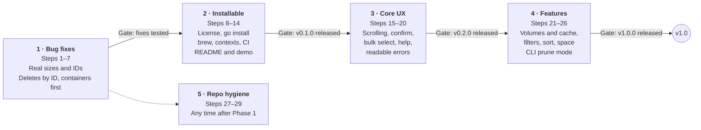

# Docker Cleaner — Implementation Roadmap

_Last updated: 2026-10-17_

## Overview

Fix the correctness bugs first, then make the tool installable, then build the UX and features that make it worth installing. There are 29 steps in five phases. Work through them in order, and treat each numbered step as one small PR.

Phases 1–4 run in order, each ending at a release gate. Phase 5 is small housekeeping that fits alongside them.

How to use this plan:

- **Order matters within a phase.** A step that depends on an earlier one says so under **Depends on**.
- **Start a phase only when the previous gate is met.** The exception is Phase 5, which can run any time after Phase 1.
- **Every step ends with tests.** A step is done when its **Done when** check passes and `make ci` is green.
- **Track progress in the checklist** at the end of this file.

## Phase 1: Critical bug fixes (steps 1–7)

The tool currently shows wrong sizes and IDs, and it can delete the wrong item or a running container. Fix these before anyone else uses it. **Gate:** all seven steps merged, each with a test.

### 1. Put the Docker client behind an interface

- **Files:** `docker/client.go`, new `docker/fake_test.go`
- **Change:** Define a small `API` interface with `ListImages`, `ListContainers`, `RemoveImage`, `RemoveContainer` and `Ping`. Have `Fetch*`, `PerformCleanup` and `Model` accept it instead of `*client.Client`.
- **Why first:** Steps 2–7 can then be unit-tested against a fake, with no running Docker daemon.
- **Done when:** `PerformCleanup` has a test that uses a fake client.

### 2. Show real container sizes

- **Files:** `docker/client.go` (`FetchDockerContainers`)
- **Change:** Pass `Size: true` in `ListContainersOptions`. Without it the daemon returns 0 for `SizeRw` and `SizeRootFs`.
- **Note:** Size calculation makes the call slower when there are many containers. If that becomes noticeable, load sizes in the background.
- **Done when:** Sizes match `docker ps -as`.

### 3. Fix image ID display

- **Files:** `docker/client.go` (`ShortID`)
- **Change:** Strip the `sha256:` prefix before cutting to 12 characters. Image IDs currently show as `sha256:e757`.
- **Done when:** IDs match the `IMAGE ID` column of `docker images`, and a test covers both prefixed and bare IDs.

### 4. Show the space a container delete actually frees

- **Files:** `models/model.go` (`updateItems`)
- **Change:** Show `SizeRw` as the size. Show the image size separately, like `docker ps -s` does: `12 MB (virtual 1.2 GB)`. Removing a container never frees its image's layers.
- **Depends on:** 2
- **Done when:** The test for this formatting is updated.

### 5. Track selections by ID, not row number

- **Files:** `models/model.go`
- **Change:** Replace `selected map[int]struct{}` with a map keyed by Docker ID that stores the item type. After a refresh, drop IDs that no longer exist and keep the cursor within range.
- **Why:** The list is rebuilt whenever images or containers are fetched, so a row number can end up pointing at a different item.
- **Done when:** A test selects an item, rebuilds the list in a different order, and the same ID is still selected.

### 6. Delete containers before images

- **Files:** `docker/client.go` (`PerformCleanup`), `models/model.go` (`getSelectionForCleanup`)
- **Change:** Sort the selection so all containers are removed first, then images. Today the order depends on Go map iteration, which is random.
- **Depends on:** 1, 5
- **Done when:** A test selects a container and its image, and both are removed in one run.

### 7. Stop silently force-removing running containers

- **Files:** `docker/client.go`, `models/model.go`
- **Change:** Show each container's state (`running` / `exited`) in the list. Set `Force: false` by default, so deleting a running container fails with a clear message. Step 16 adds a confirmed force option.
- **Done when:** Pressing `d` on a running container leaves it running and shows why.

## Phase 2: Make it installable (steps 8–14)

Right now, the only way to run the tool is to clone the repo, install Go 1.25, and run `make`. This phase makes it a one-command install that works on any Docker setup. **Gate:** `v0.1.0` released with binaries and a Homebrew formula.

### 8. Add a license

- **Files:** new `LICENSE`
- **Change:** Add MIT or Apache-2.0. Without a license, nobody else may legally use, modify or contribute to the code.
- **Done when:** GitHub shows the license in the repo sidebar.

### 9. Fix the Go module path

- **Files:** `go.mod`, every import of `docker-cleaner/...`
- **Change:** Change `module docker-cleaner` to `module github.com/minhajul/docker-cleaner` and update the imports.
- **Done when:** `go install github.com/minhajul/docker-cleaner@latest` works on a clean machine.

### 10. Add `--version` and `--help`

- **Files:** `main.go`, `Makefile`
- **Change:** Add a `version` variable set at build time with `-ldflags "-X main.version=..."`. Parse flags with the standard `flag` package.
- **Depends on:** 9
- **Done when:** `docker-cleaner --version` prints the git tag.

### 11. Support Docker contexts

- **Files:** `models/model.go` (`InitialModel`), new `docker/context.go`
- **Change:** Use this precedence: `DOCKER_HOST`, then `DOCKER_CONTEXT`, then `currentContext` in `~/.docker/config.json`. Resolve a context through `~/.docker/contexts/meta/<sha256 of name>/meta.json` → `Endpoints.docker.Host`. If none of these is set, fall back to `NewClientFromEnv`. When the connection fails, the error should name the endpoint that was tried.
- **Why:** Colima, OrbStack, Rancher Desktop and Podman users often have no `/var/run/docker.sock`. Today they see "Docker is not running" even when it is.
- **Done when:** The tool connects under Colima without `DOCKER_HOST` set.

### 12. Add CI

- **Files:** new `.github/workflows/ci.yml`
- **Change:** Run `make ci` on every push and pull request, on `ubuntu-latest` and `macos-latest`.
- **Done when:** PRs show a required green check.

### 13. Automate releases with GoReleaser and Homebrew

- **Files:** new `.goreleaser.yaml`, `.github/workflows/release.yml`, new repo `minhajul/homebrew-tap`
- **Change:** On every `v*` tag, build for darwin, linux and windows on amd64 and arm64. Publish a GitHub Release with checksums and update the Homebrew formula.
- **Depends on:** 9, 10, 12
- **Done when:** `brew install minhajul/tap/docker-cleaner` installs `v0.1.0`.

### 14. Refresh the README

- **Files:** `README.md`, `art/`
- **Change:** Add install instructions for brew, `go install` and the release binaries. Fix the stated Go version (1.22 → 1.25). Add a keybindings table, CI and release badges, and a GIF demo recorded with [VHS](https://github.com/charmbracelet/vhs).
- **Depends on:** 13
- **Done when:** A new user can install and run the tool using only the README.

## Phase 3: Core UX (steps 15–20)

The goal of this phase is a tool that stays usable with 100+ images and never surprises the user. **Gate:** `v0.2.0` released.

### 15. Add scrolling, window sizing and the alt screen

- **Files:** `main.go`, `models/model.go`
- **Change:** Start the program with `tea.WithAltScreen()` and handle `tea.WindowSizeMsg`. Render only the rows that fit on screen, and scroll as the cursor moves. Keep section headers visible, either pinned or repeated.
- **Done when:** With 200 images, the title and footer stay on screen and the cursor never leaves the visible area.

### 16. Add a confirmation dialog

- **Files:** `models/model.go`
- **Change:** Pressing `d` opens a prompt like *"Delete 3 images, 2 containers (1.4 GB)? y/N"*. If any selected container is running, add a warning and offer `f` to force-remove it.
- **Depends on:** 5, 7
- **Done when:** No delete happens without an explicit `y` or `f`.

### 17. Add bulk selection

- **Files:** `models/model.go`
- **Change:** `a` selects everything visible, `n` clears the selection, and `space` on a section header toggles that whole section.
- **Depends on:** 5
- **Done when:** Tests cover all three keys.

### 18. Add a refresh key

- **Files:** `models/model.go`
- **Change:** `r` re-fetches images and containers and keeps any selected IDs that still exist.
- **Depends on:** 5
- **Done when:** Containers started in another terminal show up after pressing `r`.

### 19. Add a help screen

- **Files:** `models/model.go`, new `models/keys.go`
- **Change:** Define the keys with `bubbles/key` and render them with `bubbles/help`. Show a short footer, with `?` toggling the full list. This replaces the hard-coded instructions string.
- **Done when:** Every key binding appears in `?` and nowhere is it hard-coded twice.

### 20. Make errors readable

- **Files:** `docker/client.go` (`PerformCleanup`), `models/model.go`
- **Change:** Return a result for each item instead of one joined error string. Show "Deleted 4 · Failed 1", then one line per failure with its short ID and reason. For images that are in use or have several tags, offer a force retry through `RemoveImageExtended` with `Force: true`.
- **Depends on:** 16
- **Done when:** A partial failure shows which items succeeded and which failed.

## Phase 4: Differentiating features (steps 21–26)

This phase gives people a reason to use the tool instead of `docker system prune`: they can see what is taking up space and choose what goes. **Gate:** `v1.0.0` released.

### 21. Add volumes, networks and build cache

- **Files:** `docker/` (new `volumes.go`, `networks.go`), `models/model.go`
- **Change:** Add a section for each type. Volumes: `ListVolumes`, with dangling volumes flagged and their sizes from `DiskUsage`. Networks: `ListNetworks`, excluding `bridge`, `host` and `none`.
- **Open question:** go-dockerclient v1.13.2 has no build-cache API. Build cache is often the largest consumer of space. Either call `/system/df` and `/build/prune` directly, or move to the official `github.com/moby/moby/client`.
- **Depends on:** 15
- **Done when:** Each new section can be listed, selected and deleted.

### 22. Add filters and search

- **Files:** `models/model.go`
- **Change:** Add toggles for dangling images, stopped containers, unused images (no container references them) and items older than N days. Add `/` to search by name or tag.
- **Depends on:** 15
- **Done when:** Each filter has a table-driven test against the fake client.

### 23. Add sorting and item age

- **Files:** `models/model.go`
- **Change:** `s` cycles the sort order: size, age, name. Show the age on each row, such as "3 weeks ago".
- **Done when:** The largest image is first after one press of `s`.

### 24. Show reclaimable space

- **Files:** `models/model.go`, `docker/client.go`
- **Change:** Add a header with `DiskUsage` totals per type, like `docker system df`, and a live "Selected: 2.3 GB" counter.
- **Depends on:** 4, 21
- **Done when:** Totals match `docker system df` to within rounding.

### 25. Add a non-interactive mode

- **Files:** `main.go`, new `cmd/` package
- **Change:** Add `docker-cleaner prune --dangling --stopped --older-than 30d --dry-run --yes`, which uses the same filters as the TUI. This lets people run it in scripts, cron and CI runners.
- **Depends on:** 10, 22
- **Done when:** `--dry-run` lists what would be deleted and exits 0 without deleting anything.

### 26. Make the protect-list configurable

- **Files:** `docker/client.go` (`systemImageRepos`), new `config/` package
- **Change:** Read extra protected patterns from `~/.config/docker-cleaner/config.yaml`. Show "N system items hidden" and add a key to reveal them as read-only.
- **Done when:** A user-added pattern hides matching images, and a test covers it.

## Phase 5: Repo hygiene (steps 27–29)

These steps are small and don't block anything else. Fit them in any time after Phase 1, ideally before the first public release.

### 27. Clean up tracked and ignored files

- **Files:** `.gitignore`, `.mcp.json`
- **Change:** Move the entries for personal tools (`.puku-cli/`, `.antigravitycli/`, `.idea`) into your global gitignore. Stop tracking `.mcp.json`. Make sure `coverage.out` stays ignored.
- **Done when:** A fresh clone contains only project files.

### 28. Add issue and PR templates

- **Files:** new `.github/ISSUE_TEMPLATE/bug.yml`, `feature.yml`, `.github/pull_request_template.md`
- **Change:** Have the bug form ask for OS, the Docker runtime (Desktop, Colima, OrbStack, Podman) and the output of `docker-cleaner --version`.
- **Depends on:** 10
- **Done when:** New issues open with the form.

### 29. Generate a changelog

- **Files:** `.goreleaser.yaml`, `CONTRIBUTING.md`
- **Change:** Use Conventional Commits, which you already do, and let GoReleaser group them into release notes. Add the commit-message convention to `CONTRIBUTING.md`.
- **Depends on:** 13
- **Done when:** The `v0.1.0` release notes list its fixes and features.

## Progress checklist

All 29 steps in the order to implement them. Size is a rough estimate: S is under 2 hours, M is half a day, L is a day or more. Update **Status** as PRs land.

| # | Step | Phase | Size | Depends on | Status |
| --- | --- | --- | --- | --- | --- |
| 1 | Docker client behind an interface | 1 · Bugs | M | — | Done |
| 2 | Show real container sizes | 1 · Bugs | S | — | Done |
| 3 | Fix image ID display | 1 · Bugs | S | — | Done |
| 4 | Show space a container delete frees | 1 · Bugs | S | 2 | Done |
| 5 | Track selections by ID | 1 · Bugs | M | — | Done |
| 6 | Delete containers before images | 1 · Bugs | S | 1, 5 | Done |
| 7 | No silent force-remove of running containers | 1 · Bugs | S | — | Done |
| 8 | Add a license | 2 · Install | S | — | Done |
| 9 | Fix the Go module path | 2 · Install | S | — | Done |
| 10 | `--version` and `--help` | 2 · Install | S | 9 | Done |
| 11 | Docker context support | 2 · Install | M | — | Done |
| 12 | CI workflow | 2 · Install | S | — | Done |
| 13 | GoReleaser and Homebrew tap | 2 · Install | M | 9, 10, 12 | Done |
| 14 | README refresh and demo GIF | 2 · Install | S | 13 | In progress |
| 15 | Scrolling, window size, alt screen | 3 · UX | L | — | Done |
| 16 | Confirmation dialog | 3 · UX | M | 5, 7 | Done |
| 17 | Bulk selection | 3 · UX | S | 5 | Done |
| 18 | Refresh key | 3 · UX | S | 5 | Done |
| 19 | Help screen | 3 · UX | S | — | Done |
| 20 | Readable per-item errors | 3 · UX | M | 16 | Done |
| 21 | Volumes, networks, build cache | 4 · Features | L | 15 | Done |
| 22 | Filters and search | 4 · Features | M | 15 | Not started |
| 23 | Sorting and item age | 4 · Features | S | — | Not started |
| 24 | Reclaimable space summary | 4 · Features | M | 4, 21 | Not started |
| 25 | Non-interactive `prune` mode | 4 · Features | L | 10, 22 | Not started |
| 26 | Configurable protect-list | 4 · Features | M | — | Done |
| 27 | Clean up tracked and ignored files | 5 · Hygiene | S | — | Done |
| 28 | Issue and PR templates | 5 · Hygiene | S | 10 | Done |
| 29 | Changelog via GoReleaser | 5 · Hygiene | S | 13 | Done |
